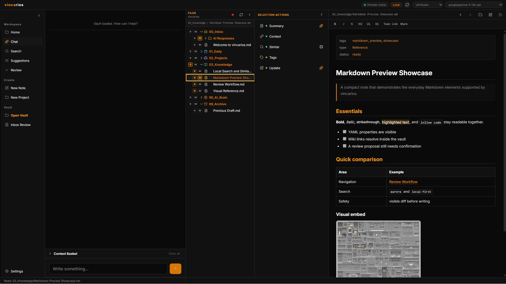
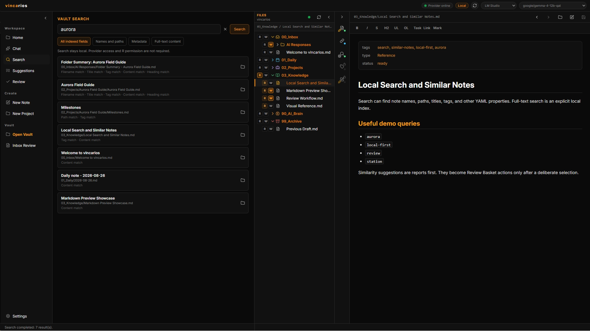
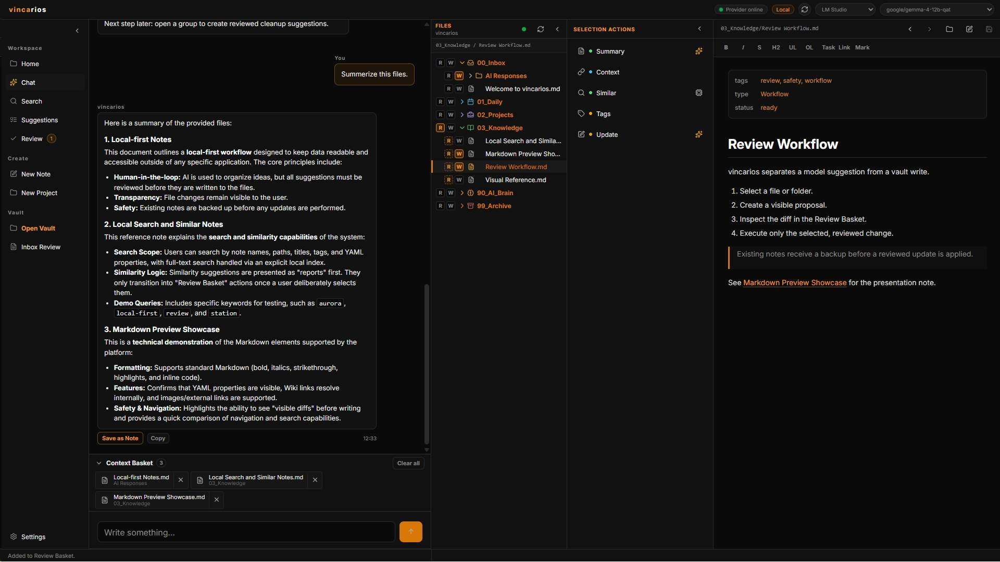
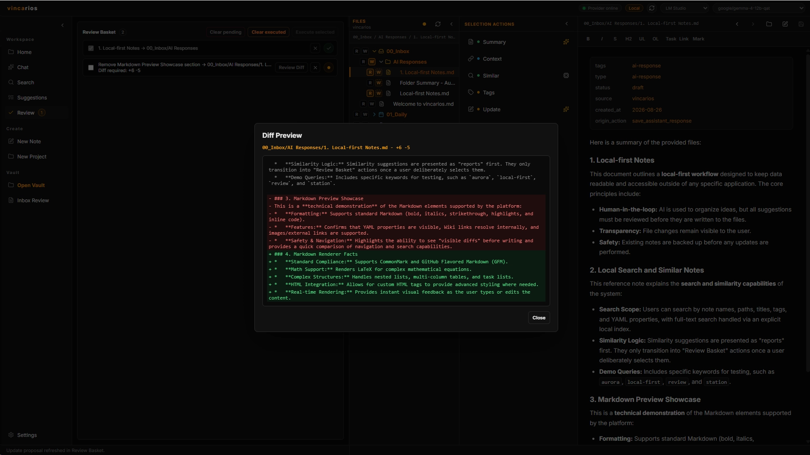
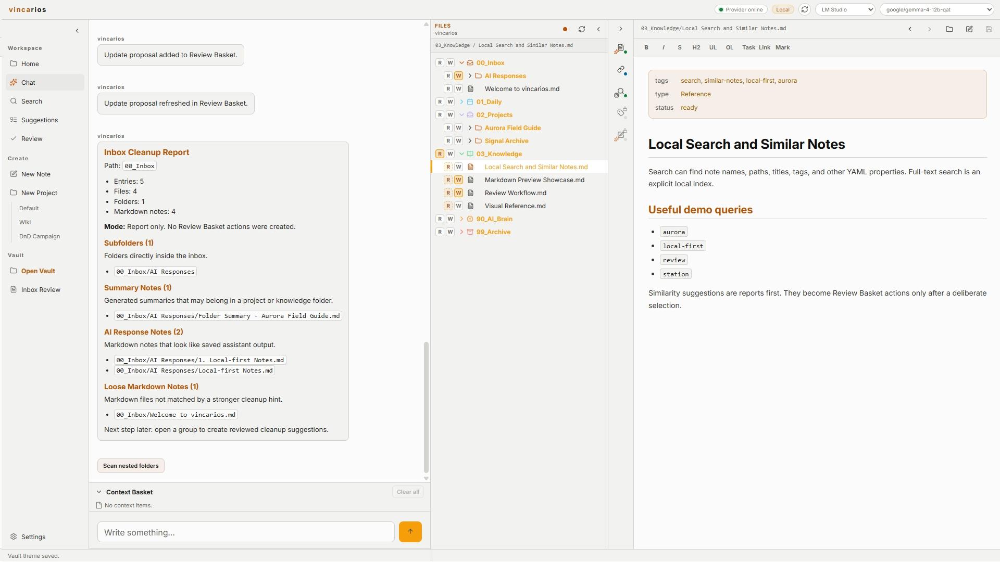
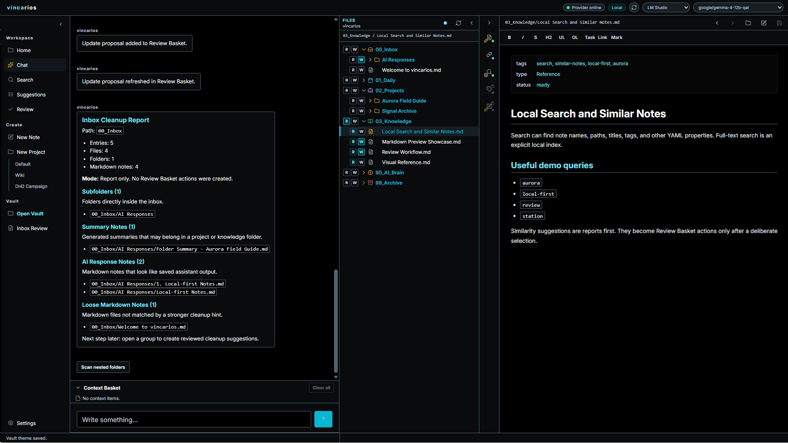
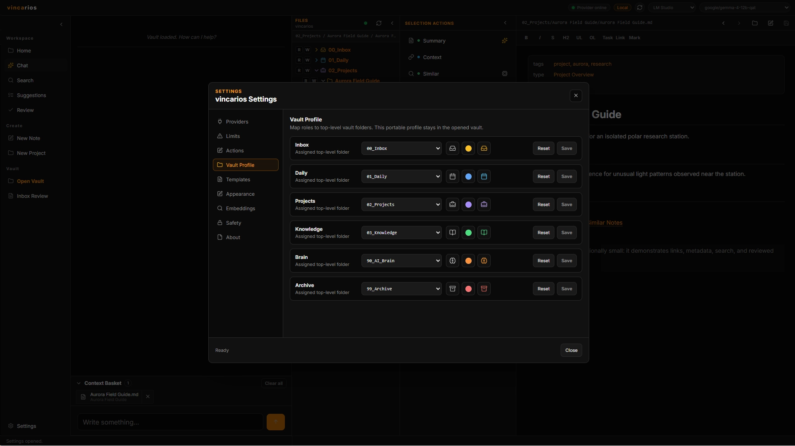
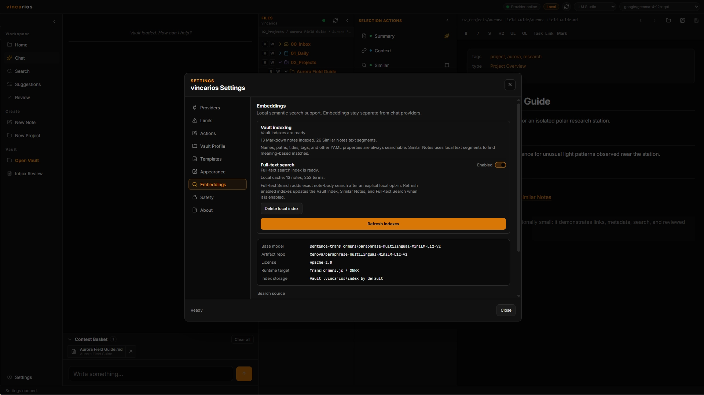

<p align="center">
  <picture>
    <source media="(prefers-color-scheme: dark)" srcset="src/renderer/assets/brand/vincarios-logo-dark.svg">
    
  </picture>
</p>

<h1 align="center">vincarios</h1>

<p align="center">A local-first Markdown workspace with explicit AI context and reviewed note changes.</p>

vincarios is a local-first Markdown and project workspace for safely analyzing, organizing, connecting, and updating notes through visible, reviewable actions. It works well with Obsidian-style vaults without attempting to replace Obsidian.

> **Project status: discontinued, no longer maintained.** vincarios is provided as-is.
> Active development has ended. No future updates, bug fixes, compatibility/security updates
> or technical support will be provided. Issues and pull requests are not accepted;
> security reports will not be processed or answered. Independent forks are welcome.

**Source only, GPL-3.0-only.** No official EXE or installer is distributed. The final snapshot retains the tested `0.1.0-beta.1` package identifier; it is not a stable 1.0 release or an announcement of a continuing beta program. See [CONTRIBUTING.md](CONTRIBUTING.md) for independent-fork guidance.



| Local Search | Local AI And Explicit Context |
|---|---|
|  |  |
| **Review Before Writing** | **Light Mode** |
|  |  |

Screenshots use demonstration notes. Model-generated text in a proposal is illustrative, not a specification of app capabilities. Note-content changes use the review workflow; settings and local cache writes are separate.

<details>
<summary>More screenshots: themes, vault profiles and indexing</summary>

### High-Contrast Theme



### Vault Profile



### Local Indexes



</details>

## Development Approach

vincarios was developed with AI assistance and human oversight. The final source snapshot received automated checks and manual Windows smoke tests. These dated checks are not a certification of security or suitability for valuable data. Start with a test vault or a backed-up copy.

## What V1 Does

- Opens and browses local Markdown vaults with File Tree, Preview, Recent Files, Vault Home, and deterministic Search.
- Supports LM Studio and Ollama as local providers.
- Uses explicit Context Basket items and Read permission before note content can be sent to a provider.
- Provides Similar Notes through local embeddings plus deterministic relevance signals.
- Creates and updates Markdown notes through a visible Review Basket, diff, backup, stale-content check, and audit log.
- Supports deterministic notes/projects from presets, Inbox reports, built-in Light/Dark theme packs, and Editor Light formatting.

## Trust Boundaries

- Providers generate text only. They do not receive filesystem access and never read or write vault files directly.
- Local navigation, Preview, Search, and index building do not require Read permission and do not add note content to provider requests.
- `R` allows an explicitly added file or folder snapshot to become provider context. `W` allows a write proposal to be created; it never writes silently.
- Existing-note changes remain reviewed whole-note proposals. They need a visible diff, backup, stale-content validation, and an audit entry before execution.
- Protected runtime/configuration folders, including `.obsidian` and `.vincarios`, are blocked from normal note actions.
- V1 uses local providers by default. If a configured endpoint is classified as external, private provider context requires explicit consent for that endpoint.
- Main owns filesystem validation and transactions. R/W state and visible review currently live in the renderer; sender checks are not independent proof of human approval against compromised code in the trusted application frame.

## Local Data

vincarios keeps app-local state beside the app in `.vincarios/` (Electron data, cache, and app settings). Each opened vault may contain its own `.vincarios/` folder for rebuildable indexes, recent-file history, Review Basket working state, backups, and audit logs.

Do not commit private vault data, `.obsidian/`, `.vincarios/`, model caches, backups, or `.env` files. The supplied `.gitignore` covers the local development defaults.

Notes remain ordinary files; no special export is needed to open them in another Markdown editor. Back up the whole vault, including any wanted local history, before changing or removing app data. See [Restore a Note From Backup](docs/RESTORE_FROM_BACKUP.md).

## Run From Source On Windows

Requirements:

- Node.js `>= 22.12.0`
- Windows 10/11 x64 is the platform target; other architectures and macOS/Linux are not certified by this project.
- A local provider is optional for browsing and Search; use LM Studio or Ollama for chat and provider-backed actions.

Download the repository's source ZIP and extract it into a writable folder, or clone the source. Open PowerShell in that folder. A source ZIP does not include dependencies, the embedding model, private settings or a ready-to-run desktop application.

For a tagged source release, use GitHub's automatic `Source code (zip)` or `Source code (tar.gz)` download; no separate custom source ZIP is supplied. A release tag identifies its source commit, not a promise of ongoing support.

```powershell
npm ci
npm start
```

Run `npm start` once after `npm ci`; Electron downloads its desktop runtime on first launch if it is not already installed. After that initial launch, `start.bat` is an alternative launcher. It keeps Electron user data and disk cache inside the project-local `.vincarios/` folder.

The local embedding model is required only for embedding-backed features and packaging. A clean checkout can provision the six hash-pinned artifacts from their pinned Hugging Face revision:

```powershell
npm run model:provision
npm run model:verify
```

Initial dependency/runtime installation uses npm and Electron download infrastructure; model provisioning uses Hugging Face. Local chat requires a separately installed LM Studio or Ollama and a suitable model. These are not Bekarios Labs services. Once installed/provisioned, core local workflows do not depend on a Bekarios Labs server. Future availability of third-party downloads is not guaranteed.

## Verify The Project

```powershell
npm run audit:security
npm run licenses:check
npm test
```

The suite includes JavaScript checks and focused Node tests for renderer, main-process services, safety boundaries, indexing, review flows, state modules, dependency policy, model integrity, and packaging contracts.

## Build Your Own Windows Portable Application

```powershell
npm ci
npm run model:provision
npm run build:win
```

The output is written to `release/`. This is a self-build option, not an official binary download. Builds are Windows-only and unsigned; Windows may show an unknown-publisher warning. The maintainer's closure build is for internal verification only; no executable is attached to the source release or uploaded as a CI artifact. Anyone redistributing a build is responsible for their own packaging, source/license compliance and update policy.

## V1 Limits

- No cloud provider is configured by default.
- No trusted/yolo mode or silent vault writes.
- Existing-note updates replace the reviewed whole Markdown note; partial section editing is not implemented.
- No plugin system, full Obsidian-plugin compatibility, vision workflows, PDF/audio/video handling, mobile app, or multi-window workflow.
- Theme Editor/shareable theme packages, advanced YAML editing, link repair, drag-and-drop move, and batch internal-link insertion are not implemented. The [historical backlog](docs/rebuild/VINCARIOS_POST_V1_BACKLOG.md) is reference material for independent forks, not a release commitment.
- Folder-context packets are bounded snapshots, not live folders. Replace a packet explicitly to capture later note changes.
- Indexing excludes hidden notes and dot-prefixed folders, including third-party history/backup folders. Refresh enabled indexes once to remove entries from an older cache; notes and backups are not deleted.
- Map notes can be read as Markdown, including properties, tables, local image embeds and note links. Other applications' interactive maps and Obsidian plugin-specific rendering are not reproduced.
- Pinned dependencies and checksums do not provide ongoing security updates. Review dependencies yourself before building or maintaining a fork.

## License

Copyright (C) 2026 Bekarios Labs. vincarios is licensed under the GNU General Public License v3.0 only. See [LICENSE](LICENSE).

Commercial use and redistribution are permitted under the GPL's terms; distributing a derived work carries the corresponding license and source-code obligations. No separate commercial license is currently offered for vincarios.

## Contact

General creator contact: [dev@bekarioslabs.de](mailto:dev@bekarioslabs.de). This is not a technical-support or security-reporting service. No issue triage, pull-request reviews, merges or replies to security reports are provided. Do not send private vault contents. See [SECURITY.md](SECURITY.md) for the unmaintained-source policy.

## Support The Creator

vincarios is free. To say thanks, you can leave a [voluntary tip](https://buy.stripe.com/cNicN7b8KejV4Z39WtbjW00). It is not needed to download or use the source, and nothing is given in return: no products, services, updates or support.

## Bekarios Labs

[bekarioslabs.de](https://bekarioslabs.de) |
[Legal notice (Impressum)](https://bekarioslabs.de/impressum) |
[Privacy policy (Datenschutz)](https://bekarioslabs.de/datenschutz)

## Documentation

- [Product Brief](docs/rebuild/VINCARIOS_V1_PRODUCT_BRIEF.md)
- [Architecture](docs/rebuild/VINCARIOS_V1_ARCHITECTURE.md)
- [Safety Rules](docs/rebuild/VINCARIOS_V1_SAFETY_RULES.md)
- [Restore a Note From Backup](docs/RESTORE_FROM_BACKUP.md)
- [Security Policy](SECURITY.md)
- [Contributing](CONTRIBUTING.md)
- [Third-Party Notices](THIRD_PARTY_NOTICES.md)
