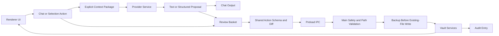

# vitruvios V1 Architecture

## Core Shape

```text
UI
-> Review Store
-> Action Parser / Action Builder
-> Safety Gate
-> Vault Services
-> Backup + Audit
-> Provider Layer
-> Embedding Index
```

## Main Principle

The LLM never reads or writes files directly. It returns structured suggestions. The app decides what is valid, visible, reviewable, and executable.
## V1 Request And Write Flow



Provider services have no vault-service edge. They receive only request-scoped text prepared by vitruvios and never own path validation, backups, audit entries, or execution.

## Suggested Source Structure

```text
src/
  main/
    app/
    vault/
    safety/
    actions/
    backup/
    audit/
    providers/
    embeddings/
    settings/
  renderer/
    shell/
    chat/
    review/
    files/
    context/
    permissions/
    markdown/
    projects/
    settings/
    prompts/
    selectionActions/
    suggestions/
    sessionLog/
    selection/
  shared/
    actions/
    schemas/
    vaultProfile/
    pathRules/
    config/
    types/
tests/
docs/
```

## Required Separation

- Provider modules generate text or embeddings only.
- Vault services read/write/list files only after safety validation.
- Safety rules are code-side laws, not prompt wishes.
- Prompt rules live in a dedicated module, not scattered through UI code.
- Renderer modules are browser-first. They must use loaded `window.vitruvios...` APIs before CommonJS `require(...)` fallbacks; `require(...)` exists only so the same modules can run in Node tests.
- Review state is its own concept, not just chat messages.
- Suggestions are their own concept between analysis and Review Basket execution. They must not be hidden in chat text.
- Context control and permission state are their own modules, not hidden inside chat or file-tree rendering.
- The bootstrap entry should initialize modules only; it must not become a large orchestration file.


## Vault Profile And Folder Roles

App logic should use folder roles instead of hard-coded vault folder names.

Current source of truth: `src/shared/vaultProfile/defaults.js`. Always read that file before assuming role names.

Phase 5.4 defaults are English:

```text
inbox     -> 00_Inbox
daily     -> 01_Daily
projects  -> 02_Projects
knowledge -> 03_Knowledge
brain     -> 90_AI_Brain
archive   -> 99_Archive
```

Consumers should ask for roles such as `inbox`, `projects`, or `knowledge` through the vault profile helpers. They should not hard-code default folder names in workflow logic. Forks and future Options UI can add or override roles through the profile without rewriting consumers.

The active Vault Profile is portable vault metadata at selected-vault `.vitruvios/profile.json`. `src/main/vault/vaultProfileService.js` validates and persists one active mapping of standard roles to existing, non-dot top-level folders, plus one icon/color visual per assigned role. `src/shared/vaultProfile/folderVisuals.js` owns fixed built-in icon ids, fixed palette ids, legacy migration, and the portable visual record. `src/renderer/vaultProfile/vaultProfileState.js` is the shared renderer read model; the File Tree displays it but never changes it. `src/renderer/settings/mountSettingsPanel.js` is the sole configuration surface. Settings selects a built-in Lucide icon or a safe static SVG already placed in selected-vault `.vitruvios/icons/`, plus one fixed palette color. `profile.json` stores only the SVG relative path; Main creates a safe Data URL only for renderer display. V1 has no SVG file-import dialog and no arbitrary custom hex colors. Folder-profile changes are low-risk configuration writes, deliberately outside Review Basket, Markdown backups, and content audit entries.
## Settings Plan

Settings are app configuration, not provider logic.

V1 Settings categories:

- `providers`: active provider, selected models, local URL overrides.
- `limits`: provider timeout, model-list timeout, selected-file context cap, folder/file listing caps, analysis file cap, and review suggestion cap.
- `vaultProfile`: folder role overrides for Inbox, Daily, Projects, Knowledge, Brain, and Archive.
- `theme`: app base mode plus validated Vault theme-pack selection.
- `safety`: review-required and future trusted-mode flags. Trusted mode is not V1 behavior.

The settings store persists normalized JSON under the portable app data folder `Vitruvios_AGENT/.vitruvios/settings.json`, not under Windows `AppData`. If a legacy `userData/settings.json` exists, startup migrates it to the portable path and removes the old file. Provider services consume the provider category through `providerSettingsState`, but providers do not own settings persistence, UI, vault access, backups, or safety rules. Vault Profile is intentionally not app-local settings: it is selected-vault metadata consumed by folder-role helpers and Templates.

Theme ownership is deliberately split: `src/shared/themes/themePacks.js` owns the fixed built-in pack registry and its allow-listed token values, Vault Profile persists only the normalized `themeOverride` and `themePackId`, and `src/renderer/theme/themeController.js` is the sole owner that writes validated pack tokens to the document root. V1 ships `High Contrast` (dark base, turquoise/blue accents) and `Paper` (light base, warm surfaces and compact radii). No theme pack reads arbitrary CSS, JavaScript, or `.obsidian` data. A future Theme Editor or JSON package import must validate a narrow token schema before it can reuse this controller.

## Provider Plan

V1:

- LM Studio chat through the shared provider registry and OpenAI-compatible chat/model endpoints.
- Ollama chat through the shared provider registry and Ollama-native `/api/tags` and `/api/chat` endpoints.
- Provider definitions own default URLs and endpoint paths; Settings can override local provider URLs without changing provider modules.
- The topbar shows provider and model dropdowns. The Provider layer still never reads or writes vault files.
- One local embedding provider path.

Later:

- OpenAI-compatible APIs.
- OpenRouter.
- Claude/Anthropic.
- Separate remote-context approvals.

## Embedding Plan V1-Light

Embeddings are search support, not automation authority.

```text
Markdown file -> chunks -> local index -> candidates -> review suggestions
```

Use for:

- similar notes
- possible links
- possible tags
- possible target folders

Index behavior:

- Similar Notes searches the selected vault's local index only. Its default internal scope is `same_role`: active Vault Profile role paths define the candidate boundary, and an unassigned target falls back deterministically to its current top-level area. `whole_vault` is explicit per run.
- `embeddingCandidateEligibility.js` owns candidate boundaries. `embeddingCandidateScorer.js` owns calibrated relevance: 70% selected embedding score, 18% meaningful filename-token overlap, and 12% shared project-path affinity. `embeddingCandidateRelationship.js` owns the report-only relationship label: equal indexed hashes are `Exact duplicate`; high relevance with a substantially matching title is `Possible duplicate`; remaining accepted results are `Related note`. The user-facing percentage is calibrated relevance, not raw cosine similarity. Whole-vault cross-role candidates require title or structural evidence; a raw vector score alone is not enough.
- Current relevance facts are path/title/profile only. YAML tags and richer deterministic metadata remain owned by the later structured Metadata Index; Similar Notes must not create a parallel hidden metadata store.
- `Refresh index first` remains an explicit per-search option. Settings > Embeddings also exposes the selected vault index state and an explicit Build, Refresh, or Rebuild control; opening a vault never starts indexing.
- runs as a local background job, not as a blocking UI operation.
- uses limits and batching for large vaults.
- uses hashes/modified timestamps so unchanged files are not re-indexed unnecessarily. A model/schema fingerprint guards compatible search; a mismatch requires an explicit rebuild.
- builds the next manifest/documents pair in memory and replaces the stored pair only after embeddings succeed, preserving the previous usable index on a failed refresh.
- stores index data outside normal vault notes in the selected vault's `.vitruvios/index` folder by default. `.vitruvios` remains blocked from normal AI/file-tree context and is used only by internal main-process services.

Model behavior:

- V1 base model decision: `sentence-transformers/paraphrase-multilingual-MiniLM-L12-v2`.
- V1 Transformers.js artifact source: `Xenova/paraphrase-multilingual-MiniLM-L12-v2`, because that repo is explicitly structured for Transformers.js with ONNX weights.
- Default license follows the Apache-2.0 base model card.
- Default dimensions: 384.
- Runtime target: Transformers.js / ONNX.
- Model artifact storage is prepared under project `.vitruvios/models/embeddings/...` through `src/main/embeddings/embeddingModelStore.js`. Local development artifacts are verified against source, license, revision, expected file list, and the recorded ONNX SHA256 before use.
- Current expected artifact set is `config.json`, tokenizer files, `unigram.json`, and `onnx/model_quantized.onnx`; the quantized ONNX SHA256 is recorded in the model store before download wiring.
- `src/main/embeddings/embeddingRuntimeService.js` owns local inference. It loads the local model path through Transformers.js/ONNX, sets `allowRemoteModels=false`, caches the extractor, and returns vectors only. It must not read vault files, write vault files, or call chat providers.
- `src/main/vault/vaultMarkdownSource.js` owns recursive Markdown discovery for internal indexes. It scans Markdown files only and skips protected dot folders such as `.vitruvios` and `.obsidian`.
- `src/main/embeddings/embeddingIndexer.js` coordinates Markdown source, runtime, and index store. It splits YAML frontmatter from body text, chunks Markdown, embeds changed documents, reindexes legacy records that lack split vectors, skips unchanged hash/mtime records, and stores vectors under the selected vault `.vitruvios/index`. Its explicit refresh is atomic from the app perspective: a failed embedding run retains the prior manifest/documents pair.
- `src/main/embeddings/embeddingIndexStatusService.js` owns read-only stored-index inspection (`no_vault`, `no_index`, `ready`, `rebuild_required`, `unavailable`, and `invalid`). It returns no vault paths or note titles and never builds an index. `embeddingIndexHealthService.js` owns embedding-specific transient `stale` and `indexing` state only. `src/main/vault/vaultChangeService.js` owns the one debounced filesystem watcher for the selected vault; it ignores protected dot folders, refreshes the File Tree through a narrow renderer event, and marks Markdown/folder changes stale without indexing automatically. Future internal indexes extend this shared change boundary rather than adding competing watchers or status indicators.
- `src/main/embeddings/embeddingSimilaritySearch.js` owns local similar-note lookup. It reads stored vectors, supports deterministic `content`, `metadata`, and `mixed` scoring modes, applies Settings/default thresholds and result limits, can explicitly rebuild the selected vault index before a search when requested, computes ranked `similar_note` candidates, and never creates review actions by itself.
- Packaging direction: keep model artifacts out of Git. Prefer bundling the embedding model with official release builds/installer if size remains acceptable. Developer/source users can use a controlled download script or app download flow.
- Settings may allow a custom local embedding model path.
- `intfloat/multilingual-e5-small` remains a later optional custom-model candidate, not the bundled default, because its license is MIT rather than Apache-2.0.
- Switching embedding models requires a clear reindex notice.
- Embedding models are separate from chat providers and must not grant providers vault access.
- No cloud embeddings in V1.

Do not use for:

- automatic cleanup
- hidden whole-vault ingestion
- irreversible decisions

## V1 Search And Structured Metadata Direction

The structured metadata index is a V1 companion to the embedding index. It is separate from vectors, does not become a second vault authority, and builds on the shared Frontmatter Contract below.

Purpose:

- store deterministic vault facts that should not be inferred repeatedly from embeddings or chat history.
- support deterministic Vault Search, Recent Files, Vault Home, and later suggestions for tags, links, project context, folder destinations, duplicate/merge workflows, and cleanup reports.
- keep semantic vector search and structured metadata separate so each can evolve independently.

Storage target:

```text
<selected-vault>/.vitruvios/index/metadata/
  manifest.json
  records.jsonl
```

`.vitruvios` remains blocked from normal AI context, File Tree context, and user note workflows. Only internal main-process services may read or write this folder.

Planned record fields:

- `schemaVersion`
- vault-relative `path`
- `pathHash`
- source `mtimeMs` and content hash
- filename and filename stem
- display title from the first H1 when available, otherwise the filename stem
- parsed frontmatter as a generic property map plus normalized `tags`, `type`, `status`, and `aliases` search fields
- detected template role and folder-role hints when already available from existing app metadata
- stale marker when the source file changed after indexing

Design rules:

- Metadata index writes are internal cache writes, not vault-note writes and not Review Basket actions.
- Metadata index data must never be treated as authority for changing files. It can only create suggestions or improve ranking.
- Executable changes still require concrete Review Basket proposals with current/proposed content, diff, backup, stale check, and audit.
- Embeddings may rank semantic similarity; metadata may explain structure. Merging both should happen in suggestion builders, not inside provider modules.
- The index must be rebuildable from the selected vault. It must not contain private data that is not derivable from the opened vault.
- The index must be schema-versioned so V1.1/V1.2 can rebuild or migrate safely.
- Missing or malformed YAML must fail soft: path, filename, title, and later text search remain available while metadata for that record is marked unavailable.
- The metadata index reads unknown frontmatter fields generically and preserves them. It does not invent, normalize, or rewrite them.

### Frontmatter Contract

The shared Frontmatter Contract now lives at `src/shared/metadata/frontmatterContract.js`. It is the only parse/validate/preserve/serialize boundary for generated-note metadata, YAML tag proposals, and Preview properties. It uses pinned `yaml@2.9.0` through a browser-first runtime adapter and applies two pre-parse limits: 64 KiB frontmatter and 32 levels of YAML flow nesting. Every parser or conversion error, including `RangeError`, fails soft: Preview retains the original Markdown source and write helpers refuse to rewrite malformed frontmatter.

The V1 search surface starts with normalized `tags`, `type`, `status`, and `aliases` alongside the generic preserved property map. The record format must retain unknown fields so Book/Template properties such as `characters`, `manuscript_status`, or user-defined values can later be indexed without a parser replacement.
### Combined Index Health

`src/main/metadata/vaultIndexHealthService.js` owns the aggregate health boundary for the selected vault. `src/main/vault/vaultIndexFreshnessService.js` captures one lightweight path/mtime inventory and compares every enabled index against that shared snapshot, including after restart. `src/main/vault/vaultChangeService.js` feeds the aggregate boundary debounced, protected-folder-filtered change events. A safe batch of explicit Markdown file paths incrementally updates only affected Metadata records and matching freshness entries; it does not trigger embeddings or Full-text rebuilds, which remain stale. Folder/unknown events, incomplete inventory, or any incremental read/write failure fail closed to the normal stale state and visible manual refresh. The renderer uses the same event only to refresh the visible File Tree while preserving navigation state; overlapping refreshes coalesce into one follow-up reload instead of being dropped. The visible `Refresh indexes` action captures a fresh inventory, rebuilds metadata first, and only then refreshes available embeddings and enabled full-text. The narrower Similar Notes `Refresh index first` option intentionally remains embedding-only. This boundary is read-only until the user explicitly invokes refresh; it does not permit providers to access vault files. Manual File Tree refresh remains an explicit fallback for filesystem watcher edge cases.

### Search And Index Lifecycle

- `src/main/search/vaultSearchService.js` owns deterministic query composition over the selected vault's existing Metadata and optional Full-text stores. It validates a bounded query, returns only path/title/app-generated match reasons, and never reads Markdown files or calls a provider while searching.
- Basic deterministic Search uses metadata facts for filename, path, title, and supported frontmatter fields. Full-text Search is an explicit per-vault opt-in. Its local cache lives under `<selected-vault>/.vitruvios/index/search/`, is ignored by Git, and stores normalized token plus heading references rather than full Markdown copies. Valid frontmatter is excluded from token extraction; malformed frontmatter remains fail-soft searchable as source text and is never rewritten by this index.
- `src/main/ipc/registerVaultSearchIpc.js` exposes only `search:query`; Preload exposes it as `window.vitruvios.search.query`. `src/renderer/search/mountSearchWorkspace.js` owns Search UI and delegates Preview and File Tree navigation through the existing File Panel APIs.
- `src/main/search/fullTextIndexer.js` owns deterministic cache construction and reuse. `fullTextIndexHealthService` owns its enabled/no-index/ready/stale state. `vaultIndexHealthService` is the aggregate boundary: the shared Refresh indexes action rebuilds metadata first, then available embeddings, then enabled full-text; the single vault watcher only marks enabled full-text stale.
- Settings provides a persistent Full-text enabled switch, first-build disclosure, and Delete local index. One visible aggregate refresh action rebuilds every enabled index; switching off preserves the rebuildable cache but excludes Full-text from aggregate refresh and stale state. Delete removes only manifest/term cache files and deliberately preserves the preference for a later rebuild.
- V1 does not encrypt the local search cache. Encryption with a key stored on the same device would add portability and recovery risk without meaningfully protecting the vault from a local attacker.
- Semantic Search remains a later explicit embedding mode. It must never silently replace exact deterministic results.
- Files shows one compact aggregate state; Settings shows enabled components. Green means all enabled components are current, amber means an enabled component is stale/building, red means a required core component is unavailable, and gray means an optional component is deliberately disabled.
- `vaultChangeService` is the only selected-vault filesystem watcher. It does not poll, never auto-rebuilds indexes, and sends no vault content to providers. Do not add competing watchers or status dots.

Later consumers after V1 Search:

- link candidates from known unresolved/outgoing links plus embedding similarity.
- folder/destination candidates from role hints, existing paths, tags, and semantic similarity.
- richer tag/YAML suggestions using existing vault tag patterns without broad stopword lists.
- duplicate and merge reports that can show why files are related before proposing any write action.
## First Audits

Run a focused audit after each block:

1. project scaffold and dependency choice
2. vault path/safety layer
3. action schema and review store
4. provider integration
5. embedding index
6. first full cleanup workflow

## Module Responsibility Rules

- `chat` renders messages and sends model requests; it does not own vault writes.
- `review` owns proposal state, selected items, statuses, and execution requests.
- `files` owns file tree navigation, file-tree keyboard navigation, and selected path state.
- `selectionActions` owns deterministic actions shown for the currently selected file/folder. It must use app state and action registries, not broad prompt phrases. `actionCategories` owns behavior color categories, `actionRegistry` owns target-to-action mapping, and `mountSelectionActions` owns the visible panel.
- `suggestions` owns grouped analysis results before they become Review Basket proposals. It should store suggestion groups/items, selected suggestion state, dismiss state, and selected-detail preview state. It must not execute vault writes.
- `sessionLog` owns per-session UI messages for visible app activity. Persistent audit logs remain main-side audit service responsibility.
- `selection` owns scoped selection behavior such as region-aware `Ctrl+A` and right-click select/copy commands.
- `context` is split by responsibility: `contextState` stores the active target and explicit Context Basket items, `mountContextBasket` owns the visible basket UI, `pendingActionState` stores one open request-scoped clarification, `blockedActionState` stores retryable app actions that were blocked by missing permissions or stale target state, `contextIntent` remains a narrow fallback only, `contextLimits` owns central request-size caps, `folderContextController` owns selected-folder scope decisions, and `contextPackageBuilder` builds request-scoped provider context from explicit Context Basket items. Future dropped Markdown files, folder indexes, and embedding candidates should extend this module family instead of adding hidden rules to chat or file-tree code.
- `permissions` owns Read/Write state and inheritance display.
- `providers` talk to LM Studio/Ollama; they never access files.
- `vault` reads/writes/lists files only after safety validation. Reviewed template writes may create folders through `createFolder` and notes through `createNote`; folders are created before files.
- `embeddings` discovers Markdown, chunks content, runs local embeddings, stores indexes, and searches. It only returns candidates; it never performs cleanup or writes vault notes.
- `settings` owns app configuration categories, normalization, persistence, and Settings UI/IPC. Settings UI should use a category menu plus active content pane instead of a single ever-growing modal body. Provider modules consume provider settings but do not own settings storage.
- `templates` owns deterministic note/project preset definitions, materialization, and conversion from create plans to review proposals. Presets target vault folder roles instead of hard-coded folder names and return create plans; they do not write files directly. Multi-folder/multi-file project presets enter review as one `create_from_template` proposal instead of flooding the basket with separate file entries.
